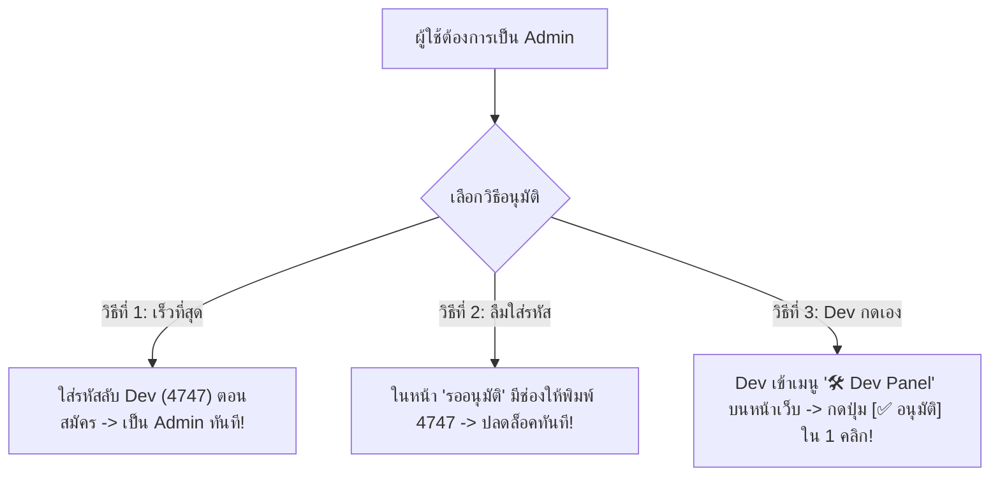

# ระบบสรุปค่าตอบแทนดันเจี้ยน (Dungeon Payout System)
**บริษัท สี่เจ็ดเช็ดหยั่ง จำกัด** | Firebase Project: `revenge-b80cd`

---

## 🚀 1. วิธี Deploy เพื่อส่งเป็นลิงก์เว็บ (Live URL)

ไฟล์คอนฟิกสำหรับ Firebase Hosting (`firebase.json` และ `.firebaserc`) ได้ถูกสร้างไว้ให้ในโฟลเดอร์นี้เรียบร้อยแล้วครับ

### ⚡ วิธีที่ 1: Deploy ผ่าน Firebase Hosting (แนะนำ ได้ลิงก์ฟรีตลอดชีพ)
เปิด Command Prompt หรือ PowerShell ในโฟลเดอร์โปรเจกต์ `C:\Users\User\.gemini\antigravity\scratch\dungeon-payout-app` แล้วพิมพ์คำสั่ง:

```bash
# 1. เข้าสู่ระบบ Firebase (ทำแค่ครั้งแรก)
firebase login

# 2. ทำการ Deploy ขึ้นเว็บทันที
firebase deploy
```

เมื่อ Deploy เสร็จ จะได้ลิงก์เว็บพร้อมแชร์ให้ทุกคนทันที เช่น:
👉 **`https://revenge-b80cd.web.app`** หรือ **`https://revenge-b80cd.firebaseapp.com`**

---

### 🌐 วิธีที่ 2: Deploy แบบลากแล้ววาง (ไม่ต้องพิมพ์คำสั่งเลย)
หากยังไม่ได้ติดตั้ง Firebase CLI ในเครื่อง:
1. เข้าเว็บ: https://app.netlify.com/drop
2. ลากโฟลเดอร์ `dungeon-payout-app` ไปวางในหน้าเว็บ
3. จะได้ลิงก์เว็บออนไลน์ทันทีใน 5 วินาที พร้อมแชร์ใช้งานได้เลย!

---

## 🔑 2. ระบบอนุมัติสิทธิ์ Admin แบบที่ "ง่ายที่สุด" (ไม่ต้องเปิด Database เลย!)

ระบบถูกปรับปรุงใหม่ให้สามารถอนุมัติได้ **3 วิธีที่ง่ายที่สุดบนหน้าเว็บโดยตรง**:



### ✨ วิธีที่ 1: รหัสลับ Dev อนุมัติทันที (ง่ายที่สุด ไม่ต้องรอใคร)
- **Dev แจ้งรหัสลับ**: รหัสผ่านเริ่มต้นคือ **`4747`**
- เมื่อผู้ดูแลสมัครสมาชิก ให้ใส่รหัส `4747` ในช่อง **"🔑 รหัสลับ Dev เพื่อเป็น Admin ทันที"**
- ระบบจะทำการอนุมัติสิทธิ์ Admin ให้ทันที 100% ตั้งแต่เสร็จสิ้นการสมัคร!

### ⚡ วิธีที่ 2: ปลดล็อคเองจากหน้ารออนุมัติ
- หากตอนสมัครไม่ได้กรอกรหัสลับ ในหน้าต่าง *"รอการอนุมัติสิทธิ์ Admin"* จะมีช่อง:
  `⚡ มีรหัสลับ Dev ไหม? ปลดล็อคทันทีได้ที่นี่: [ 4747 ] [ปลดล็อค]`
- กดปุ่มเดียวจะปลดล็อคกลายเป็น Admin ทันที

### 🛠️ วิธีที่ 3: Dev กดอนุมัติผ่าน "Dev Approval Panel" บนหน้าเว็บ
- Dev ไปที่หน้าเว็บ กดไอคอนกุญแจ 🔐
- กดลิงก์ด้านล่าง: **"🛠️ เข้าสู่ Dev Panel (สำหรับผู้พัฒนากดอนุมัติ)"**
- ใส่ Master Key: `4747`
- หน้าต่างจะแสดงรายชื่อคนที่สมัครค้างไว้ทั้งหมด
- Dev แค่กดปุ่มสีเขียว **`[✅ อนุมัติ]`** รายชื่อนั้นจะได้รับสิทธิ์ Admin ทันทีแบบ Realtime!

---

## 🔒 การรักษาความปลอดภัยสำหรับ User ทั่วไป
- ผู้เล่นทั่วไปจะไม่เห็น Toolbar, ปุ่มเพิ่มรอบ, ปุ่มลบ, หรือเมนูใดๆ ของ Admin เลย
- ผู้เล่นสามารถเปิดลิงก์เว็บ ดูสลิป กรองดูยอดเงินรายบุคคล และดูสรุปผลตอบแทนผ่านมือถือได้ 100%
